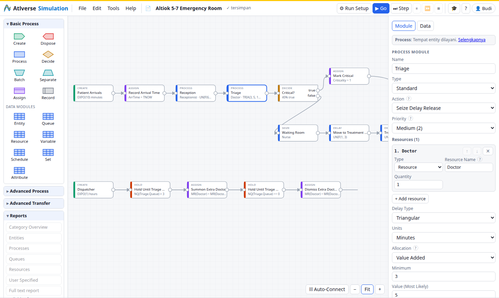
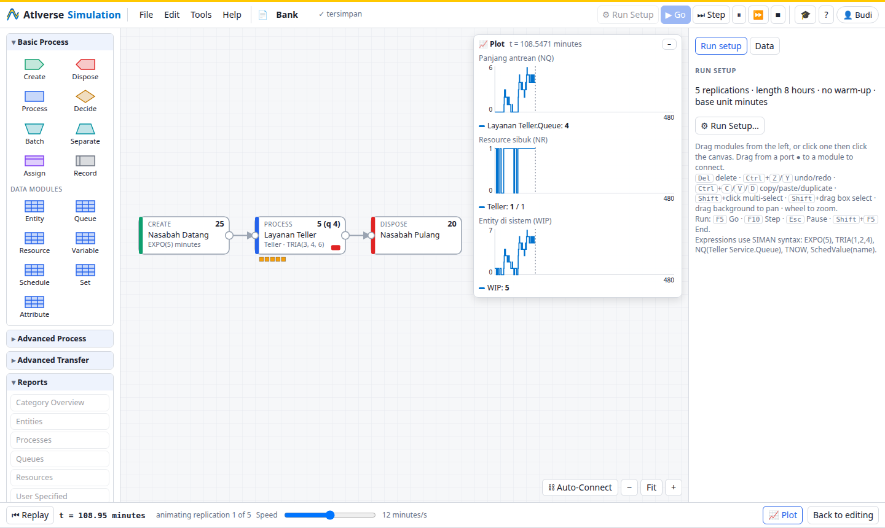
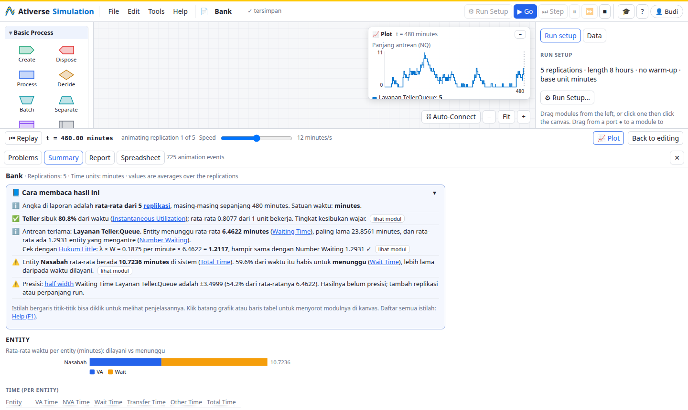
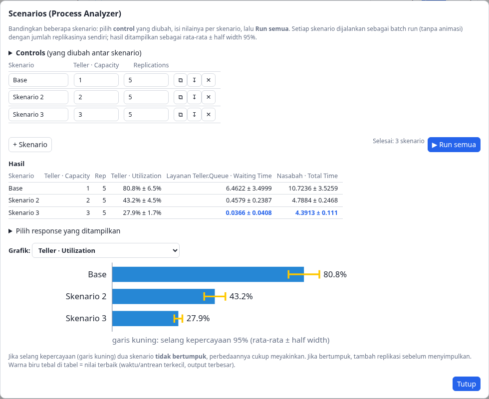
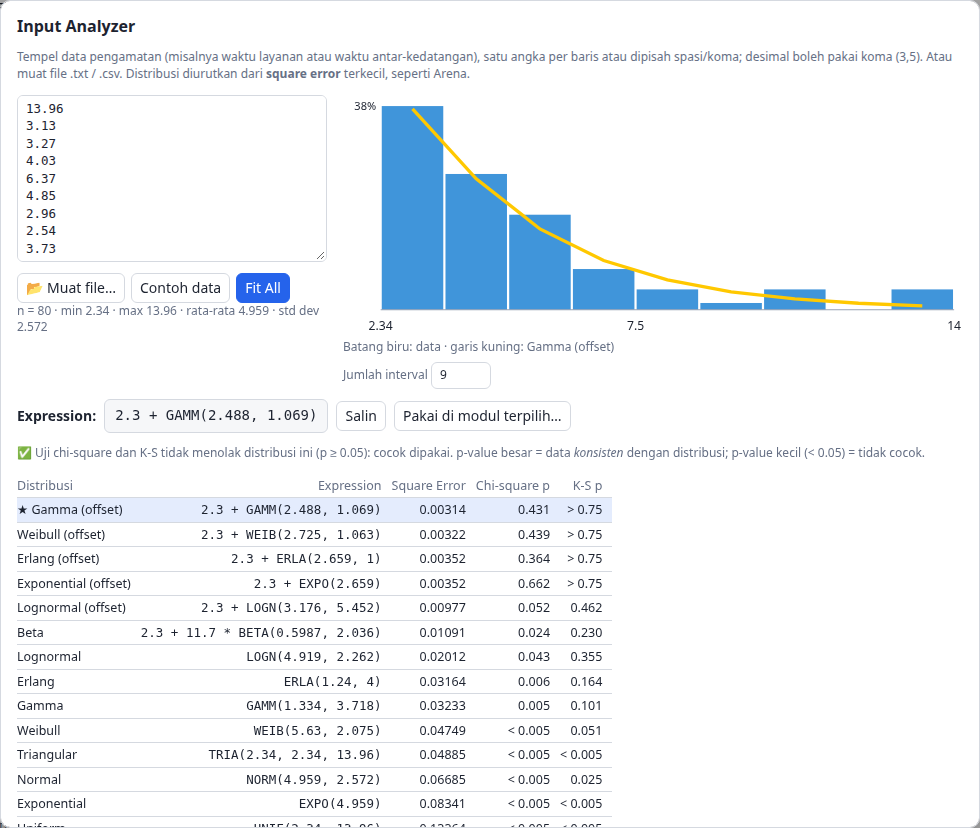
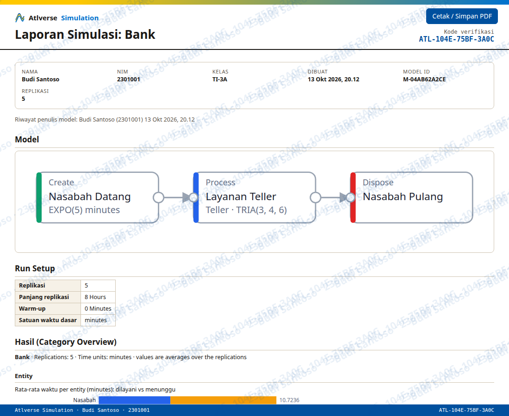
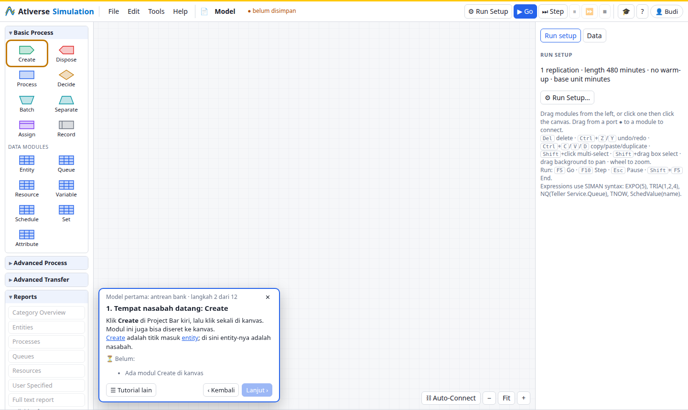

<p align="center">
  
</p>

<p align="center">
  <b>Discrete-event simulation for teaching, in Python and in the browser.</b><br>
  Build models from Arena-style modules, run them, watch the animation and read the report —
  nothing to install for students.
</p>

<p align="center">
  <a href="https://atlverse-simulation.pages.dev"><b>▶ Open the app</b></a> ·
  <a href="#quick-start">Quick start</a> ·
  <a href="#features">Features</a> ·
  <a href="#expressions">Expressions</a> ·
  <a href="#bahasa-indonesia">Bahasa Indonesia</a>
</p>



Atlverse Simulation is a discrete-event simulation engine written in Python (package
`simcore`) with a web editor on top. The engine implements the SIMAN modelling language —
entities flowing through blocks, resources and queues, schedules, transfer (stations, routes,
transporters, conveyors, guided vehicles), combined discrete/continuous models and
batch-means statistics — and the editor offers the familiar Basic Process, Advanced Process
and Advanced Transfer modules. The whole thing also runs **inside the browser** (Pyodide), so
a class can use it from a link, each student's laptop doing its own simulation.

Results are statistically comparable to Arena, not digit-for-digit identical (event ordering
on ties differs). [`COVERAGE.md`](COVERAGE.md) lists every SIMAN block and element and its status.

## Features

| | |
|---|---|
| **Modelling** — drag modules onto the canvas and connect them; module dialogs follow Arena's prompts; data modules for Entity, Queue, Resource, Schedule (with a graphical editor), Variable, Set, Expression, Statistic, Failure, StateSet, Transporter, Conveyor. Live validation, undo/redo, copy/paste. | **Animation** — after a run, replication 1 is replayed: entities move between modules, queue counts and resource states update, and live plots draw queue lengths, resources busy and work in process. Go, Step, Pause, Fast-Forward, End, as in Arena. |
|  |  |
| **Reports** — Category Overview (Entity, Process, Queue, Resource, User Specified) with half widths across replications, the full text report, charts, and a *"how to read these results"* box that explains utilization, waiting time, Little's law and precision in plain language. | **Scenarios** — a small Process Analyzer: choose controls (resource capacity, variable values, time between arrivals), run every scenario with its own replications, compare responses with 95% confidence intervals. |
|  |  |
| **Input Analyzer** — paste observed data, see the histogram, fit UNIF, TRIA, NORM, EXPO, ERLA, GAMM, LOGN, WEIB, BETA and POIS (with offsets), ranked by square error with chi-square and Kolmogorov–Smirnov p-values, and put the expression straight into a module. | **Student reports** — students enter their name and student number once; *File → Laporan* produces an HTML/PDF report with the model diagram, Run Setup, results and scenarios, watermarked on every page with a verification code. *File → Periksa laporan* lets the lecturer check that a report was not edited and which students saved the model. |
|  |  |
| **Guided tutorials** — step-by-step tutorials (a first queueing model, Decide, Assign, Schedule) that check each step in the model before going on, plus a glossary of about 60 terms (F1). The learning aids are in Bahasa Indonesia; module and report terms stay in English, as in Arena. | **Runs anywhere** — a local server (`python -m simcore.web`) or a static site (`python -m simcore.web.build`) for GitHub Pages, Cloudflare Pages, Netlify or a campus web server. Works offline after the first visit. |

## Quick start

**In the browser:** open <https://atlverse-simulation.pages.dev>, or host your own copy
(see [In the browser](#in-the-browser)).

**On your computer** (Python 3.10+, no other packages needed; PyYAML only for YAML files):

```bash
git clone https://github.com/andrewtliem/atlverse-simulation.git
cd atlverse-simulation
python -m simcore.web            # opens http://127.0.0.1:8765, models saved in ./models
```

Example models from Altiok & Melamed, *Simulation Modeling and Analysis with Arena*, chapter 5
(5-2 workstation, 5-6 two processes, 5-7 emergency room) are under *File → Open…*.

## Three ways to build a model

**1. Web editor** — as above. Shortcuts: Del, Ctrl+Z/Y, Ctrl+C/V/D, Ctrl+A, Ctrl+S,
F5 (Go), F10 (Step), Esc (Pause), Shift+F5 (End), F1 (Help).

**2. YAML** — the engine's own model format (`simcore/loader.py` documents every key):

```bash
python -m simcore examples/bank.yaml --reps 10
```

**3. Python API**:

```python
from simcore import *

m = Model("M/M/1", time_units="minutes")
m.resource("Server")
m.add(Create(interval="EXPO(1)"), Queue("Server.Queue"), Seize(resources=[("Server", 1)]),
      Delay(duration="EXPO(0.8)"), Release(resources=[("Server", 1)]), Dispose())
m.replicate(replications=5, length=10_000)
res = m.run()
print(res.report())
print(res.across("queues.Server.Queue.waiting_time.average"))
```

Any operand also accepts a Python callable `fn(entity, model)`, and `Call(fn=...)` runs Python
code in the flow.

## Expressions

Expressions use SIMAN syntax, e.g. `TRIA(1, 2, 4)`, `NQ(Triage.Queue) > 3 .AND. Size == 2`,
`TNOW - ArrTime`. Named expressions go in the **Expression** data module (the replacement for
SIMAN's obsolete `DISTRIBUTIONS`/`DIST`).

| Group | Supported |
|---|---|
| Distributions | `EXPO` `UNIF` `TRIA` `NORM` `LOGN` `GAMM` `ERLA` `BETA` `WEIB` `POIS` `DISC` `CONT` `JOHN` (and the two-letter forms `EX` `UN` `TR` …), optional stream argument |
| Math | `ABS` `SQRT` `EXP` `LN` `LOG` `SIN` `COS` `TAN` `ASIN` `ACOS` `ATAN` `HSIN` `HCOS` `HTAN` `INT` `NINT` `AINT` `ANINT` `MOD` `AMOD` `MN` `MX` `AMIN1` `AMAX1` |
| Time and run | `TNOW` `TFIN` `NREP` `MREP` `J` |
| Queues | `NQ` `AQUE` `ENTATRANK` |
| Resources and sets | `NR` `MR` `IRF` `STATE` `RESUTIL` `RESSEIZES` `MEMBER` `MEMIDX` `NUMMEM` |
| Statistics | `TAVG` `TMAX` `TMIN` `TNUM` `TSTD` `THALF` `DAVG` `DMAX` `DMIN` `NC` |
| Entities | `Entity.Type` `Entity.SerialNumber` `Entity.Picture` `Entity.CreateTime` `IDENT` `EntitiesIn` `EntitiesOut` `EntitiesWIP` `NE` `NG` `NSG` `NB` `NSTO` |
| Schedules | `SchedValue` |
| Logic | `==` `<>` `<` `<=` `>` `>=` `&&` `\|\|` and `.EQ.` `.NE.` `.LT.` `.LE.` `.GT.` `.GE.` `.AND.` `.OR.` `.NOT.` |

## In the browser

```bash
python -m simcore.web.build dist          # static site: editor + engine (Pyodide) + example models
python -m http.server -d dist 8000        # try it at http://localhost:8000/
```

`dist/` runs entirely in the browser: the engine is this package running in Pyodide inside a
Web Worker, loaded from cdn.jsdelivr.net on the first visit and then cached by `sw.js` for
offline use. Put the folder on any static host — GitHub Pages (`.nojekyll` included), Netlify
or Cloudflare Pages (`_headers` included):

```bash
npx wrangler pages deploy dist --project-name <your-project>   # Cloudflare Pages
```

Saved models stay in each browser; *File → Export JSON* gives students a file to hand in.
The End button keeps partial results when the page is cross-origin isolated (`_headers` on
Netlify/Cloudflare, `sw.js` elsewhere). Long runs are slower in the browser than in
CPython; a progress panel shows how far a run is.

## Random numbers

`model.rng_mode = "arena"` (default) uses L'Ecuyer's MRG32k3a streams and substreams (legacy
16807 streams when SEEDS are given) with fast classic samplers; `"exact"` uses statistically
exact samplers on the same streams. `model.disable_randomness = True` replaces every
distribution by its mean.

## Project layout

| Path | Contents |
|---|---|
| `simcore/core.py` | entities, queues, resources, variables, simulation loop |
| `simcore/blocks.py` | SIMAN blocks |
| `simcore/model.py` | elements, expression resolver, replication runner, statistics collection |
| `simcore/transfer.py`, `guided.py` | free-path transporters, conveyors, guided vehicles |
| `simcore/continuous.py` | levels, rates, CSTATS, DETECT |
| `simcore/rng.py`, `stats.py` | random numbers and distributions, tallies, half widths |
| `simcore/loader.py` | YAML format and Arena-style modules (process, decide, batch, …) |
| `simcore/web/` | editor: `api.py` (shared by server and browser), `server.py`, `build.py` (static site), `static/` (page, `worker.js`, `browser.js`, `learn.js`, `report.js`, `scenarios.js`, `analyzer.js`, `plots.js`) |
| `branding/` | logo (SVG and PNG) |

## Tests

```bash
python -m unittest discover -s tests       # engine, loader, editor graph conversion, build
# browser tests (headless Chrome; set PLAYWRIGHT_CORE to playwright-core's index.mjs if needed),
# with `python -m simcore.web --no-browser` running:
node tests/ui/editor.test.mjs
node tests/ui/learn.test.mjs
node tests/ui/tutorials.test.mjs
node tests/ui/tools.test.mjs
# the static build across several visits (serve dist/ first):
BASE=http://127.0.0.1:8790/ node tests/ui/revisit.test.mjs
```

## Bahasa Indonesia

Atlverse Simulation adalah aplikasi simulasi sistem diskrit untuk perkuliahan. Mahasiswa cukup
membuka <https://atlverse-simulation.pages.dev> di browser — tidak perlu instalasi; simulasi
berjalan di laptop masing-masing. Fitur untuk kelas:

- **Tutorial terpandu** (🎓): model antrean pertama, Decide, Assign dan Schedule; setiap langkah
  diperiksa otomatis.
- **Help & istilah** (F1): sekitar 60 istilah laporan dan modul dijelaskan dalam Bahasa Indonesia;
  judul kolom di Summary bisa diklik.
- **Cara membaca hasil**: penjelasan otomatis di atas Summary (utilisasi, waktu tunggu, Hukum
  Little, half width).
- **Identitas mahasiswa** (👤) dan **File → Laporan HTML/PDF** dengan watermark nama, NIM dan
  kode verifikasi; dosen memeriksa keaslian laporan lewat **File → Periksa laporan**.
- **Tools → Scenarios** untuk membandingkan skenario, **Tools → Input Analyzer** untuk mencari
  distribusi dari data.

## License and trademarks

[MIT](LICENSE) © 2026 Andrew Tanny Liem.

Atlverse Simulation is an independent project. It is not affiliated with, endorsed by or
sponsored by Rockwell Automation. Arena and SIMAN are trademarks of Rockwell Automation, used
here only to describe compatibility. The example models are built from the exercises in
Altiok & Melamed, *Simulation Modeling and Analysis with Arena* (Academic Press, 2007).
